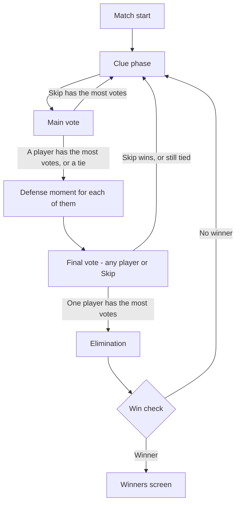

# CrabCover — Game Spec

**This is the single source of truth for how the game works.** Build against this document.

It merges three sources:
- `Docs/PRD.md` — PRD v2.0 (vision, features, tech)
- `GameFlowSpec.md` — the old screen-by-screen flow (now deleted; still in git history)
- `Docs/SPEC_DECISIONS.md` — the decisions that resolved every conflict between the two (the
  "why" behind the rules here)

Where this spec and the PRD or GameFlowSpec disagree, **this spec wins.**

> **Status:** ✅ complete — every rule decided, except the word pack file format, which is
> postponed (§12).

---

## 1. Overview

- **Game:** 3D multiplayer tabletop social deduction party game. Players are crabs sitting around a
  table, playing a hidden-word game (Undercover-style) with voice chat.
- **Players:** **4 to 10** per match. Maximum 10 people in a session, including spectators.
- **Platform:** PC, Steam.
- **Match length:** roughly 5-10 minutes.
- **Core idea:** most players get the same secret word. A few get a similar but different word, or
  no word at all. Everyone describes their word without saying it, then votes on who seems off.

---

## 2. Roles

| Role | Side | Secret word | Told their role? | Wins when | Host setting | Min players |
|---|---|---|---|---|---|---|
| **Civilian** | Civilians | Civilian word | No — only sees their word | Every Undercover **and** Mr. Blank is eliminated | Always on | — |
| **Undercover** | Undercover | Undercover word (similar to the Civilian word) | No — only sees their word | Undercover count ≥ everyone else still in the match | Always on | — |
| **Mr. Blank** | **Neutral** (alone) | **None** (blank card) | Sees a blank card | Voted out **and** guesses the Civilian word correctly | On/off | 6 |
| **Jester** | **Neutral** (alone) | Civilian word | **Yes** | Gets voted out | On/off | 5 |
| **Spirit** | Civilians | Civilian word | **Yes** | With the Civilians | On/off | 5 |

**Sides:**
- **Civilians** oppose every other role.
- **Undercover** try to survive until they equal or outnumber everyone else.
- **Mr. Blank** and the **Jester** are **neutral**. Each plays alone and **never shares a win** with
  the Civilians or the Undercover. When the Civilians or the Undercover win, Mr. Blank and the
  Jester lose.

**The Spirit** is not a separate side — it is an extra ability given to one random Civilian:
- The player knows they are the Spirit from the start. Nobody else knows.
- If voted out, the Spirit becomes a ghost who **can still talk and vote**, but no longer gives
  clues.
- Once voted out, the Spirit does **not** count as "in the match" for the win check (§8), but their
  vote still counts.

---

## 3. Role counts

Worked out when the match starts, from the number of players seated.

**Rules:**
- **Undercover:** 1 at 4-6 players, 2 at 7-8 players, 3 at 9-10 players.
- **Mr. Blank:** exactly 1 if the host turned it on **and** there are 6+ players.
- **Jester:** exactly 1 if the host turned it on **and** there are 5+ players.
- **Civilians:** everyone else.
- **Spirit:** if the host turned it on **and** there are 5+ players, one random Civilian is also the
  Spirit. This does not change any count.
- **Check:** Undercover must be fewer than Civilians. Every row below passes.

**Mr. Blank off, Jester off:**

| Players | 4 | 5 | 6 | 7 | 8 | 9 | 10 |
|---|---:|---:|---:|---:|---:|---:|---:|
| Civilians | 3 | 4 | 5 | 5 | 6 | 6 | 7 |
| Undercover | 1 | 1 | 1 | 2 | 2 | 3 | 3 |

**Mr. Blank on:**

| Players | 6 | 7 | 8 | 9 | 10 |
|---|---:|---:|---:|---:|---:|
| Civilians | 4 | 5 | 5 | 5 | 6 |
| Undercover | 1 | 1 | 2 | 3 | 3 |
| Mr. Blank | 1 | 1 | 1 | 1 | 1 |

**Jester on:**

| Players | 5 | 6 | 7 | 8 | 9 | 10 |
|---|---:|---:|---:|---:|---:|---:|
| Civilians | 3 | 4 | 4 | 5 | 5 | 6 |
| Undercover | 1 | 1 | 2 | 2 | 3 | 3 |
| Jester | 1 | 1 | 1 | 1 | 1 | 1 |

**Mr. Blank and Jester both on:**

| Players | 6 | 7 | 8 | 9 | 10 |
|---|---:|---:|---:|---:|---:|
| Civilians | 3 | 4 | 4 | 4 | 5 |
| Undercover | 1 | 1 | 2 | 3 | 3 |
| Mr. Blank | 1 | 1 | 1 | 1 | 1 |
| Jester | 1 | 1 | 1 | 1 | 1 |

**The host cannot change these counts.** If a role is turned on but there are too few players when
the match starts (for example Mr. Blank with 5 players), that role is simply left out of the match.
The lobby shows it greyed out.

---

## 4. Host settings

Set in Lobby Setup (§5.2). The host can change them in the Lineup Lobby between matches.

| Setting | Options | Default |
|---|---|---|
| Room name | Text | — |
| Lobby visibility | Public / Friends only / Invite only | — |
| Max players | Fixed at 10 | 10 |
| Mr. Blank | On / Off (6+ players) | Off |
| Jester | On / Off (5+ players) | Off |
| Spirit | On / Off (5+ players) | Off |
| Show roles | **On elimination** / At match end | On elimination |
| Voting time | 60 / 90 / 120 seconds | 90 |
| Word pack | Pick from built-in packs | — |

**Not a setting (removed from the PRD):** number of clue rounds before a vote — always 1.
**Postponed:** word pack import and difficulty (see §12).

The on/off defaults for Mr. Blank, Jester and Spirit are not decided anywhere; "Off" is a
placeholder.

---

## 5. Screens and flow

### 5.1 Main Menu
Local only. No network session yet.

- **Host Game** → Lobby Setup (§5.2)
- **Join Game** → Server Browser (§5.3)
- **Customize** → crab cosmetics (not specified yet)
- **Settings**
  - Audio: master, voice chat, music, SFX volume
  - Video: quality preset, fullscreen, brightness
  - Controls: rebindable keys (movement, push-to-talk, emotes)
- **Steam invite (Shift+Tab overlay):** accepting an invite joins directly, skipping the browser.

### 5.2 Host flow
1. **Lobby Setup screen** — host fills in the settings from §4.
2. **Create Steam session.**
   - Success → host travels to the **Lineup Lobby** map as the listen server.
   - Failure → error popup ("Failed to create session, try again"). Host stays on Lobby Setup.

### 5.3 Join flow
- **Server Browser** lists Public and Friends-only lobbies: room name, players (e.g. "6/10"),
  visibility tag. Invite-only lobbies never appear.
- **Room code:** every lobby has one. Entering a valid code joins directly.
- **Steam invite:** skips the browser.
- **Failure messages:**
  - Lobby full → "Lobby is full"
  - Bad room code → "Room not found"
  - Anything else → "Could not join lobby"
- **Success:**
  - No match running → travel to the **Lineup Lobby**.
  - Match running → travel to the **Gameplay Table** as a **spectator ghost** (§9).

### 5.4 Lineup Lobby
Shared 3D space. Everyone stands in a line facing the camera.

- Mic check icon per player.
- Customize outfit, visible to everyone.
- Everyone can view the settings (read-only). Word packs show names only, never the words.
- **Host only:** edit settings; **Start Match** button.
- **Start Match** is disabled until **4 players** are in the lobby. No ready-check.

---

## 6. Match start

When the host presses Start Match:

1. Everyone travels to the **Gameplay Table** map.
2. **Seats are random** every match (not the lineup order).
3. **Roles** are assigned using §3.
4. **Words** are given out from the chosen word pack (one Civilian word + one Undercover word).
5. **Word card:** every player has a private card they can open **at any time** during the match.
   Nobody else can see it. Mr. Blank's card is blank.

---

## 7. Round loop

### 7.1 Clue phase

- **Order:** clockwise. The first player of round 1 is a random seat. **Each new round, the first
  player moves one seat clockwise.**
- **Who gives a clue:** every awake player still in the match. Skipped: sleeping crabs (§10) and
  ghosts, including the Spirit ghost.
- **Time:** **30 seconds** per player. When time runs out, the turn passes on.
- **The clue:** describe your word **without saying it**, out loud over voice chat.
  - Any player may **type** a short clue instead. It shows in a speech bubble above their crab.
  - Mr. Blank has no word and must bluff.
- Voice chat stays open the whole time — players can talk, react and laugh.
- Crabs turn to look at whoever is speaking. They never look at another player's card.
- A small fidget prop sits on the table for players to play with (no gameplay effect).

### 7.2 Main vote

- **Who votes:** every awake player still in the match, **plus the Spirit ghost**. Sleeping crabs and
  normal ghosts do not vote.
- **How:** point your claw at a player, or at **Skip**. Votes are **visible live** — everyone sees
  the claws move.
- **Who can be voted for:** any player still in the match, including sleeping crabs. **You cannot
  vote for yourself.**
- **Time:** the host's voting time (default **90 seconds**). Players discuss and vote in the same
  window.
- **Changing your vote** is allowed until time runs out.
- **Missed vote:** counts as **Skip**. If Skip is not available this round, it counts as **no vote**.

**No-elimination limit:** after **2 rounds in a row with no elimination**, the next round has **no
Skip option** in either vote. It resets when someone is eliminated. (A round ended by Skip, a tie,
or a spared player all count as "no elimination".)

### 7.3 Main vote result

| Result | What happens |
|---|---|
| **Skip has the most votes** (more than any player) | No elimination. New clue round. |
| **One player has the most votes** | That player gets a defense moment (§7.4), then the final vote (§7.5). |
| **A tie for the most votes** — between players, or between Skip and players | **Every tied player** gets a defense moment, then the final vote. |

### 7.4 Defense moment

- Each player going to the final vote gets **30 seconds**, one at a time, alone in the spotlight.
- **Sleeping crabs get no defense moment.**
- **A sleeping crab alone with the most votes** skips the defense and the final vote, and is
  eliminated straight away.

### 7.5 Final vote

- **Same voters** as the main vote.
- **Choices:** **any player still in the match** — not only the players who defended — **or Skip**
  (unless the no-elimination limit is active). You still cannot vote for yourself.
- **Time:** **30 seconds**. Changing your vote is allowed.
- **Result:**
  - One player has the most votes → **eliminated**, even if they did not defend.
  - Skip has the most votes, or it is a tie → **no elimination**. New clue round.
- **No second defense.** The final vote always ends the voting phase.
- **Missed vote:** counts as Skip, or as no vote if Skip is not available.

**Examples:**
- Main vote: Alex 4, Skip 2 → Alex defends → final vote: Alex 2, Skip 4 → **Alex is spared.**
- Main vote: Alex 3, Bea 3 → both defend → final vote: Alex 2, Bea 4 → **Bea is eliminated.**
- Main vote: Alex 4, Skip 2 → Alex defends → final vote: Cody 4, Alex 2 → **Cody is eliminated**
  (no defense for Cody).
- Main vote: Alex 3, Skip 3 → Alex defends → final vote: Alex 3, Skip 3 → **no elimination.**

### 7.6 Elimination

- The eliminated crab is carried off the table by a seagull. (The animation may change during
  prototyping — PRD §9 also lists a shovel or beach vacuum.)
- They become a **spectator ghost** (§9). The Spirit becomes a Spirit ghost instead.
- **Role reveal:** if the host setting is **On elimination**, their role is shown now. If **At match
  end**, it stays hidden until the winners screen.
- If the eliminated player is **Mr. Blank**, they make their guess now (§8).
- Then the **win check** runs (§8).

---

## 8. Win check

Runs **after every elimination**, in this exact order. The first step that ends the match wins.

**Counting "in the match":** players who have not been eliminated. **Sleeping crabs count.** Ghosts
(including the Spirit ghost) do not.

1. **Was the eliminated player the Jester?** → **Jester wins.** Match ends.
2. **Was the eliminated player Mr. Blank?** → Mr. Blank types one guess at the Civilian word.
   - Correct → **Mr. Blank wins.** Match ends.
   - Wrong → continue.
   - A **sleeping** Mr. Blank cannot guess: counts as **wrong**.
3. **Are every Undercover and Mr. Blank out of the match?** → **Civilians win.** Match ends.
4. **Is the Undercover count ≥ everyone else in the match?** (everyone else = Civilians + Mr. Blank
   + Jester) → **Undercover wins.** Match ends.
5. **Are only Mr. Blank and one other player left in the match?** → Mr. Blank must guess **now**.
   - Correct → **Mr. Blank wins.** Match ends.
   - Wrong → Mr. Blank is out. Go back to step 3 (the Civilians win).
   - This stops the two of them voting for each other forever.
6. **Otherwise** → start a new clue round.

**Mr. Blank at the end:** if the last Undercover is voted out while Mr. Blank is still in the match,
the match **does not end**. The Civilians must also vote out Mr. Blank, who then gets their guess.
(The Civilian word has not been said out loud, so Mr. Blank still has something to guess.)

**Example — 7 players, Mr. Blank on:** 5 Civilians, 1 Undercover, 1 Mr. Blank.
- Round 1: a Civilian is voted out → 4 Civilians, 1 Undercover, 1 Mr. Blank. Step 4: 1 vs 5, no
  winner.
- Round 2: the Undercover is voted out → step 3: Mr. Blank is still in, so no winner yet.
- Round 3: Mr. Blank is voted out and guesses wrong → step 3: Civilians win.

---

## 9. Ghosts and spectators

**Spectator ghosts** are eliminated players and people who joined mid-match.
- Translucent, not seated.
- Can watch the rest of the match.
- **Cannot** give clues, vote, or touch cards and voting.
- Can gently nudge physics props on the table (PRD §5.7).
- **Voice:** living players **cannot hear** them. Ghosts can talk to other ghosts.

**Spirit ghost** — the voted-out Spirit:
- Can **talk** (everyone can hear them) and **vote**, but gives no clues.
- Cannot be voted for.
- Does not count as in the match for the win check.

**Late joiners** wait as spectator ghosts and are seated at the next match. Spectators count toward
the 10-player limit.

---

## 10. Disconnects

### Player disconnects — "sleeping crab"

- The crab **falls asleep** in its seat. The match continues.
- **Clue phase:** their turn is skipped instantly.
- **Voting:** they do not vote. It does not count as Skip.
- **Can be voted out** like any other player. No defense moment.
- **Win check:** they still count as in the match.
- **Reconnects before being voted out:** wakes up in the same seat with the same role and word. They
  can reopen their word card.
- **No time limit.** A sleeping crab stays until it reconnects or is voted out.
- **Sleeping Jester voted out → the Jester wins.** Accepted knowingly: a Jester might disconnect on
  purpose.
- **Sleeping Mr. Blank voted out → counts as a wrong guess.**

### Host disconnects

The host's computer runs the match, so **the match ends for everyone**. Show a clear "Host left"
screen with a quick way back to the lobby. Host migration is a stretch goal only (PRD §7).

### Host removes a player

The host can remove a disruptive player (PRD §5.9). There is **no vote-kick**.

If the host removes a player during a match:
- It **counts as an elimination**.
- A removed **Jester does not win**. A removed **Mr. Blank gets no guess**.
- The win check (§8) then runs **from step 3**.

---

## 11. End of match

**Winners screen:**
- Which side won, and the winning players.
- Every player's role.
- **Both words** — the Civilian word and the Undercover word.

**Play Again** (host only):
- Clears roles, words and votes.
- **Everyone** goes back to the **Lineup Lobby**. The host can change settings there.
- Eliminated players and late joiners are seated for the next match (up to 10).
- Seats are randomized again when the next match starts.

---

## 12. Other features, and what is postponed or blocked

### In the game (from the PRD)
- **Emotes:** hotkeys 1-5 — claw point, hide in shell, nervous shaking, table slam.
- **Fidget physics:** pick up and drop small table props (pearls, shovels, seaweed).
- **Voice animation:** crabs react when their mic picks up sound. **Crabs have no jaw** — use
  eyestalks, claws and body bob, not mouth or lip-sync.
- **Accessibility:** typed clues (§7.1), push-to-talk, rebindable keys, colorblind-friendly UI,
  on-screen text for all system prompts.
- **Safety:** per-player local mute; host can remove a player; no vote-kick.
- **Species:** crab, hermit crab, fiddler crab, lobster — sharing one skeleton.

### Postponed
- **Word pack file format and import** (decision D18). Phase 2 uses a small built-in list of word
  pairs. Must be decided before any word pack is shared or imported.
- **Word difficulty setting** (PRD §5.6) — depends on the word pack format.
- **Clue rounds setting** — removed for now, can come back later.
- **Alternate game modes** (PRD §4).
- **Voice captions** (PRD §10) — post-MVP.
- **Controller support** (PRD §10) — undecided.

### Blocked on a real Steam AppID
Currently on AppID 480, which has no Workshop, Cloud or Inventory:
- **Steam Workshop word packs** (PRD §5.6)
- **XP, levels, cosmetic unlocks, stats** (PRD §6)

### Tech
- **Networking:** listen server. **Steam** Online Subsystem + SteamSockets for sessions and
  joining — already working.
- **Voice:** **EOS Voice Chat** alongside Steam sessions. Not Vivox. Needs a spike in Phase 2 to
  confirm it works with Steam sessions and gives per-player volume for animation.
- The PRD §7 line "EOS for lobbies and data" does not match the build and is replaced by the above.

---

## 13. Questions answered after the first draft

| # | Question | Answer |
|---|---|---|
| Q1 | Skip ties with a player | Handled like any tie: the player defends, then the final vote. Still tied → no elimination. (§7.3) |
| Q2 | A missed vote when Skip is not available | Counts as **no vote** |
| Q3 | Can you vote for yourself? | **No** |
| Q4 | Can the defense change the result? | **Yes** — every defense is followed by a final vote (§7.5) |
| Q5 | Who is told their role? | **Jester and Spirit** are told. Mr. Blank sees a blank card. Civilians and Undercover only see their word. |
| Q6 | The Jester's word | **Civilian word** |
| Q7 | Can living players hear ghosts? | **No.** Ghosts talk to other ghosts. Only the Spirit ghost is heard by everyone. |
| Q8 | Host removes a player mid-match | Counts as eliminated. No Jester win, no Mr. Blank guess. Win check from step 3. (§10) |
| Q9 | Can the host change role counts? | **No.** A role without enough players is left out and greyed out. (§3) |

| — | Final vote choices | **Any player or Skip**, not only the defenders. No second defense. (§7.5) |
| — | Final vote time | **30 seconds** (§7.5) |
| — | Skip limit | **2 rounds in a row with no elimination** → no Skip next round. Replaces "2 Skips in a row". (§7.2) |

---

## 14. Changes from the source documents

For anyone who read the PRD or GameFlowSpec first:

| Topic | Before | Now |
|---|---|---|
| Round structure | PRD: 1-3 clue rounds, then one vote | Vote after **every** clue round |
| Minimum players | GameFlowSpec: 3 | **4** |
| Undercover count | PRD: 1-2 | **3 at 9-10 players** |
| Mr. Blank | GameFlowSpec: on the Undercover side | **Neutral**, wins alone by guessing |
| Jester | Side unclear | **Neutral**, wins alone when voted out |
| Spirit | — | **New role** |
| Undercover win | PRD: survive to the final two | **Undercover ≥ everyone else** |
| Role reveal | PRD: at elimination; GameFlowSpec: at end | **Host setting**, default at elimination |
| Ties | GameFlowSpec: re-vote until someone loses | Tied players defend, then **one final vote**; still tied → no elimination |
| Defense moment | PRD: 10s plea, then eliminated | 30s plea, then a **final vote** that can spare them |
| Role labels | GameFlowSpec: nobody is ever told their role | **Jester and Spirit** are told |
| Self-voting | Not covered | **Not allowed** |
| Timers | GameFlowSpec: none | 30s clue, 60-120s vote, 30s defense |
| Clues as text | GameFlowSpec: every player's **word** shown as text | Spoken clue; typing optional. (Showing the word itself would reveal everyone's word.) |
| Ghost vote | PRD: yes | **No** (except the Spirit) |
| Seats | PRD: players pick | **Random** |
| Turn order | PRD: fixed | Clockwise, **start rotates** |
| Disconnects | PRD: rejoin within a grace window | **Sleeping crab** |
| Networking | PRD: EOS for everything | **Steam** sessions, EOS for voice only |
